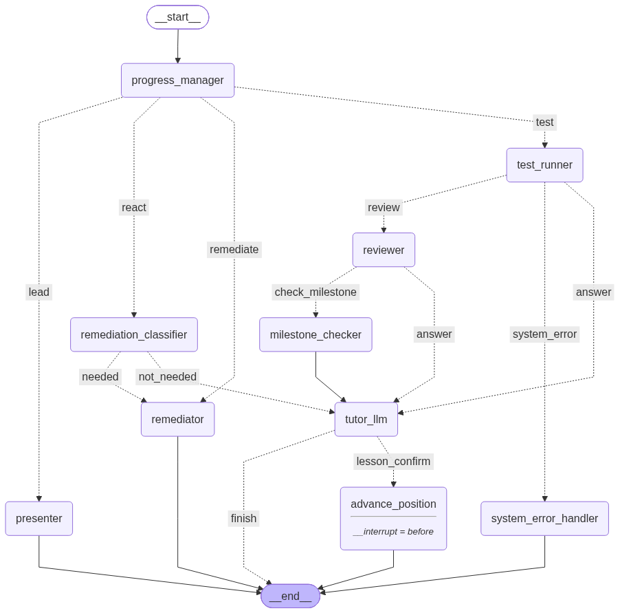

# SDET Course Agentic System

An AI tutor that teaches test automation in Python. A student gets a short lesson and a practical task, sends back their code, and the system **runs it with pytest, reviews its quality, and gives guided feedback**: hints and questions instead of ready-made answers.

It is built as a multi-step workflow with [LangGraph](https://github.com/langchain-ai/langgraph), where each step is a small, separate piece of logic (present a lesson, run tests, review code, re-explain a topic, and so on).

> **Status:** work in progress. The core learning loop works end to end in the console. A chat interface and a full course are not built yet (see [Status and roadmap](#status-and-roadmap)).
>
> The tutor talks to students in **Russian**, so lesson texts and prompts are in Russian.

## What it does

1. **Presents a lesson.** Shows the key points of the topic and gives one practical task.
2. **Runs the student's code.** Code sent in a ```` ```python ```` block is saved to a file and executed with pytest in a separate process with a time limit, so a broken or endless script cannot hang the system.
3. **Reviews the code.** An LLM checks the code against the task's criteria and four general quality patterns (meaningful names, no magic values, no duplication, readable structure) and returns a structured verdict with comments and a score from 0 to 10.
4. **Tutors, does not solve.** The tutor explains what happened (test passed or failed, and why), points out the main problem and the strengths, and guides the student with questions.
5. **Re-explains when the student is stuck.** If the student writes that they do not understand, or writes without code after failing a task twice in a row, the topic is explained again, simpler each time.
6. **Tracks a growing project.** Some tasks build one test project step by step. Every new submission also re-runs all earlier tests, so the tutor can say "your new code is fine, but it broke a test you wrote before."
7. **Checks milestones.** When all tasks of a project milestone are passed, the system runs a milestone check and the tutor celebrates the achievement.
8. **Waits for confirmation.** When a lesson is finished, the workflow pauses and asks the student before moving on.

## How it works



Every student message enters at `progress_manager` and is routed by simple rules:

| Student message | Route |
| --- | --- |
| Task not shown yet | `presenter` shows the lesson and the task |
| Contains a Python code block | `test_runner` → `reviewer` → (`milestone_checker`) → `tutor_llm` |
| Plain text, asks for help | `remediation_classifier` → `remediator` (re-explanation) |
| Plain text, anything else | `remediation_classifier` → `tutor_llm` |
| Plain text after two failed attempts in a row | `remediator` (skips the classifier) |
| pytest crashed for internal reasons | `system_error_handler` tells the student it is not their fault |

Two kinds of tasks are supported: **drill** tasks run in an isolated temporary folder, **project** tasks run inside the student's own project folder together with all previous tests.

Conversation memory: when the dialogue gets long, older messages are summarized with [LangMem](https://github.com/langchain-ai/langmem), so the context stays small.

## Project structure

```
main.py              Console entry point (demo session)
config.py            Settings: model name, timeouts, thresholds, file paths
graph/
  graph.py           Builds and compiles the LangGraph workflow
  state.py           Shared state passed between steps
  nodes/             Steps: presenter, test_runner, reviewer, tutor, remediator, ...
  edges/             Routing rules between steps
schema/              Pydantic models for structured LLM output
system_prompts/      Prompts for each LLM role
src/                 Helpers: pytest runner, progress and project-state storage, LLM setup
data/
  curriculum.json    Modules, lessons, tasks and their criteria
  project_plan.json  Project milestones
  patterns.json      Code-quality patterns used by the reviewer
img/graph.png        Diagram of the workflow
```

## Tech stack

Python · LangGraph · LangChain · LangMem · Pydantic · pytest · Loguru · Google Gemini (`gemini-2.5-flash`, via `langchain-google-genai`)

The model is configured in one place (`src/llm.py` and `config.py`).

## Getting started

You need Python 3.11+ and a Google AI (Gemini) API key.

```bash
# 1. Create and activate a virtual environment
python -m venv .venv
source .venv/bin/activate        # Windows: .venv\Scripts\activate

# 2. Install dependencies
pip install -r requirements.txt

# 3. Add your API key
echo "GOOGLE_API_KEY=your-key-here" > .env

# 4. Create the folder where the student's project tests are stored
mkdir student_workflow

# 5. Run the demo session
python main.py
```

What to expect:

- The first run shows the first lesson and task. Progress is saved to `data/progress.json`, so the next run continues from there.
- `main.py` is a simple demo: it sends one hard-coded student message. To try the review flow, edit `test_msg_for_tutor` in `main.py` so that it contains a ```` ```python ```` block with your solution, then run it again.
- After a lesson is completed, the console asks whether to move on (`да` / `нет`).
- Progress files and the student folder are listed in `.gitignore` and are not committed.

## Status and roadmap

Works now:

- the full loop: lesson → code → pytest → review → feedback → next lesson
- re-explanations with growing simplicity, regression detection across project tests, milestone checks, saved progress, conversation summaries
- a small starter curriculum: 2 modules, 3 lessons, 5 tasks (pytest basics, fixtures, a first API status-code check)

Known limitations and next steps:

- no chat interface yet, only the console demo
- the course content is small, and the milestone checks are placeholders
- the "continue to the next lesson?" answer only understands exact `да` / `нет`; an LLM-based intent check is planned
- course completion is not handled yet
- the workflow state is kept in memory only (`MemorySaver`); the student's progress itself is stored in JSON files
- the project has no automated tests of its own yet
